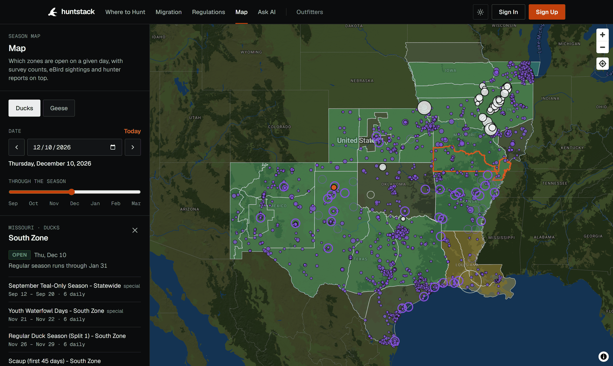
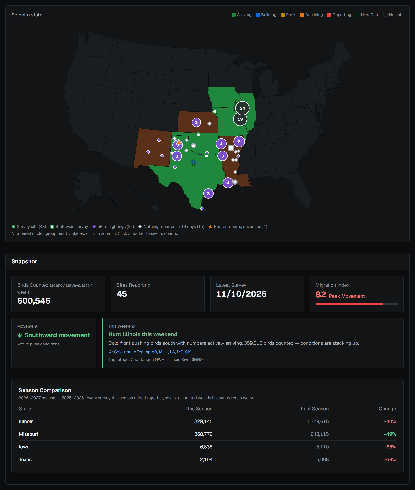
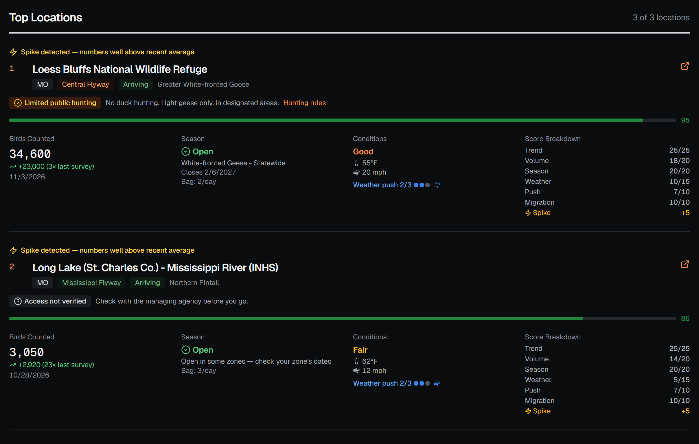
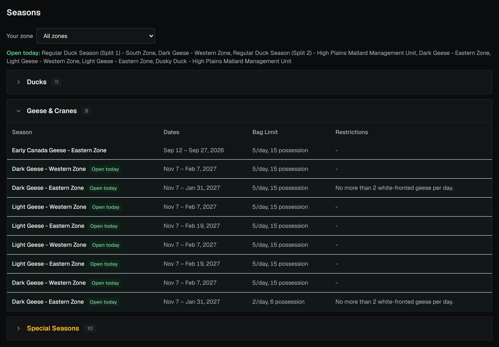
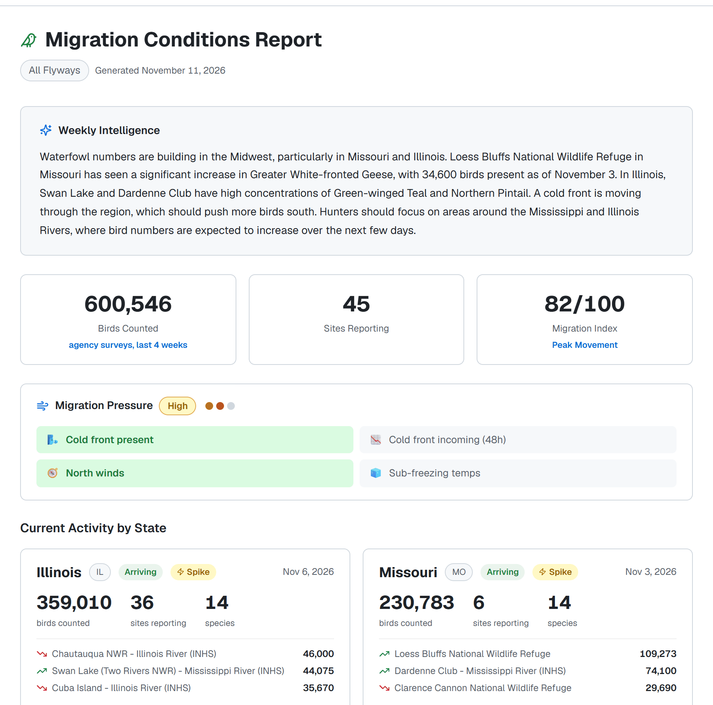
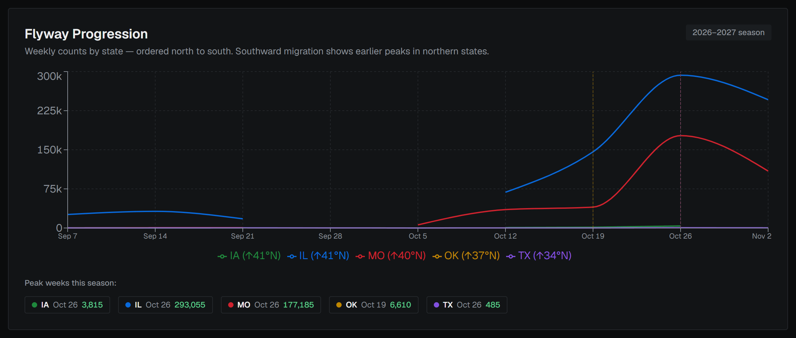

<h1 align="center">
  
  huntstack
</h1>

<p align="center">
  <i>Plan your waterfowl hunt in the Central and Mississippi flyways: season rules, refuge and survey counts, eBird sightings and hunt-day weather in one place, with an AI guide that answers from them.</i>
</p>

<p align="center">
  <b><a href="https://huntstack.net">huntstack.net</a></b>
</p>

<h4 align="center">
  <a href="https://github.com/njcurtis3/huntstack/actions/workflows/ci.yml">
    
  </a>
  <a href="https://github.com/njcurtis3/huntstack/releases/latest">
    
  </a>
  <a href="#license">
    
  </a>
  <a href="https://huntstack.net">
    
  </a>
  <br>
  
  
  
  
  
  
</h4>

<p align="center">
  <a href="#features">Features</a> ·
  <a href="#plans">Plans</a> ·
  <a href="#install">Install</a> ·
  <a href="#run">Run</a> ·
  <a href="#data-pipeline">Data pipeline</a> ·
  <a href="#api">API</a> ·
  <a href="#environment">Environment</a> ·
  <a href="#deployment">Deployment</a> ·
  <a href="#roadmap">Roadmap</a>
</p>

<p align="center">
  
</p>

## Introduction

`huntstack` replaces the way waterfowl hunters plan today: Googling across six
state websites, reading three PDFs, and scrolling Facebook groups for refuge
reports. It pulls federal and state aerial surveys, eBird sightings, NOAA
weather and state regulations into one structured dataset, and answers the
question that matters before a hunt: *where should I go this weekend?*

It does not try to be a navigation app. OnX, HuntStand and BaseMap own the
field; HuntStack's season map is for planning, with no GPS, offline maps or
property lines. **HuntStack tells you where to hunt; OnX helps you get there.**

It covers waterfowl in the Central and Mississippi Flyways: seasons, zones and
bird counts for TX, NM, AR, LA, KS, OK, MO, IL and IA, and license rules for
the first six.

HuntStack has been live at **[huntstack.net](https://huntstack.net)** since
v1.0.0 (November 2026), on desktop and phone browsers. v1.1.0 added the season
map.

> [!IMPORTANT]
> Season dates, bag limits and bird counts are informational and may be out of
> date. **Always confirm seasons, bag limits and shooting hours with the state
> wildlife agency before you hunt.**

## Features

<p align="center">
  
&nbsp;
  
</p>

<p align="center">
  
&nbsp;
  
</p>

<p align="center">
  
</p>

<table>
  <tr>
    <td colspan="2"><b>Season map</b> (<code>/map</code>)<br>Season zones for all nine states, shaded open, special season only or closed for the day you pick, for ducks or geese; step through the season day by day or with a slider. Tap a zone for its seasons, bag limits, agency links and the state's eBird activity. On top: survey sites, every eBird hotspot with a duck or goose report in the last 14 days, the eBird areas HuntStack watches, and hunter reports. Map or satellite, light or dark.</td>
  </tr>
  <tr>
    <td width="50%"><b>Migration</b> (<code>/migration</code>)<br>Refuge and aerial survey counts with week-over-week change and species trends, survey sites and eBird places on the map, flyway arrows, a season-to-date comparison and an AI-written weekly summary. Old surveys are labeled as old, never shown as current.</td>
    <td width="50%"><b>Where to Hunt</b> (<code>/where-to-hunt</code>)<br>Enter a species and a city, zip or GPS fix, and get public hunting areas ranked by recent bird counts, migration status, push factors, open seasons, weather and distance, with the score broken down on every card.</td>
  </tr>
  <tr>
    <td><b>AI hunting guide</b> (<code>/chat</code>)<br>Ask <i>"When does teal season open in Arkansas?"</i> or <i>"Where are the snow geese right now?"</i> Each question searches the web, then adds HuntStack's season records, survey counts, eBird reports and saved agency documents. Answers cite their sources, and the season records win on dates and bag limits.</td>
    <td><b>Regulations and licenses</b> (<code>/regulations</code>)<br>Seasons by zone, bag limits and shooting hours for TX, NM, AR, LA, KS, OK, MO, IL and IA, and stamps and license prices for the first six, from the agencies' own data, with a side-by-side state comparison.</td>
  </tr>
  <tr>
    <td><b>Push factors and eBird activity</b><br>Cold fronts, north winds and freezing temperatures from NOAA, scored per state and for regions such as the Texas Panhandle. eBird places and birds per state over the last 14 days, with trends from daily snapshots.</td>
    <td><b>Field reports</b><br>Signed-in hunters can <b>Report birds</b> from the Migration map. Reports show as a separate, unverified layer with locations rounded, and never count toward scores.</td>
  </tr>
  <tr>
    <td><b>Outfitters</b> (<code>/outfitters</code>)<br>A directory with full profiles and inquiries. Outfitters list, claim or edit their business and manage it from a dashboard (listing, stats, reviews, inquiries); every change goes live only after review.</td>
    <td><b>Accounts and Settings</b> (<code>/settings</code>)<br>Free accounts through Supabase. Settings shows your plan and questions used, subscribe or manage billing, your own AI key, password and sign out.</td>
  </tr>
  <tr>
    <td><b>Shareable report</b> (<code>/report</code>)<br>A one-page snapshot of current conditions, filtered by state and species.</td>
    <td><b>Native app</b> (<code>apps/mobile</code>)<br>An Expo app, Where to Hunt first, using the same API. Not released to the app stores yet; see <a href="apps/mobile/README.md">its README</a>.</td>
  </tr>
</table>

## Plans

| | Visitor | Free account | HuntStack Pro | Own AI key |
|---|---|---|---|---|
| AI questions | 3 in total | 10 a month | Unlimited | Unlimited |
| Price | Free | Free | $5.99/month | Free; your AI provider bills you |
| Everything else | ✓ | ✓ | ✓ | ✓ |

- **Pro** is billed by Stripe Checkout and managed in Stripe's billing portal from Settings.
- **Own AI key** accepts an Anthropic (Claude), OpenAI or OpenRouter API key, or a one-click OpenRouter connection. Keys are sealed with AES-256-GCM and never sent back to the browser. Claude and OpenRouter keys search the web; OpenAI keys answer from HuntStack's data only. Claude Pro and ChatGPT Plus subscriptions can't be linked, since neither company allows it.
- A question that fails doesn't count. An hourly rate limit applies to every plan.
- Accounts listed in `ADMIN_USER_IDS` are admins: unlimited, uncounted and never billed, with access to `/admin` for reviewing outfitter submissions.

## Install

<details open>
<summary>
 Prerequisites
</summary> <br />

- Node.js 22 or later, and pnpm 8 or later
- Python 3.11 or later (for the data pipeline)
- A Supabase project with the `postgis` and `vector` extensions enabled
- An OpenAI-compatible LLM key for chat and embeddings (OpenRouter in production), and an eBird API key
- Optional: a Stripe account for subscriptions

</details>

```bash
git clone https://github.com/njcurtis3/huntstack.git
cd huntstack
pnpm install
```

Create a `.env` at the repo root with the variables under
[Environment](#environment), then run `scripts/init-supabase.sql` in the
Supabase SQL editor, followed by the `scripts/add-*.sql` files for the
features you need (for example `add-accounts-billing.sql`,
`add-outfitter-self-service.sql`, `add-field-reports-table.sql`,
`add-ebird-cache-table.sql`). Each one is additive and safe to run twice.

> [!CAUTION]
> **Never run `pnpm db:push` or `drizzle-kit push`.** Drizzle will try to drop
> the pgvector `embedding` column. Make every schema change in raw SQL.

## Run

```bash
pnpm dev          # API and web together
pnpm dev:web      # web only, http://localhost:3000
pnpm dev:api      # API only, http://localhost:4000 (Swagger at /docs)
```

Checks (CI typechecks, tests and lints on every push and pull request):

```bash
pnpm --filter @huntstack/api test                # API (vitest)
pnpm --filter @huntstack/api lint
pnpm --filter @huntstack/web build
pnpm --filter @huntstack/web lint
cd apps/scrapers-python && python -m pytest      # scrapers and parsers (pytest)
```

## Data pipeline

The data pipeline runs every Monday at 12:00 UTC on GitHub Actions
(`.github/workflows/data-pipeline.yml`), and can be run by hand from the
Actions tab. From `apps/scrapers-python/`:

```bash
python -m huntstack_scrapers.pipeline status            # freshness, last runs, what's due, manual to-dos
python -m huntstack_scrapers.pipeline update all        # every automatic job that's due (--force, --dry-run)
python -m huntstack_scrapers.pipeline update "counts:*" # named jobs or patterns
python -m huntstack_scrapers.pipeline list
```

Runs are logged in `pipeline_runs`, and warnings and failures go to
`SCRAPER_ALERT_WEBHOOK`. Manual jobs (the Central Flyway midwinter report,
season extraction, Arkansas AGFC reports) show up in `status` but never run on
their own.

<details>
<summary>
 Data sources
</summary> <br />

| Source | State | How | Frequency |
|---|---|---|---|
| Washita NWR, Salt Plains NWR | OK | FWS survey pages | weekly |
| Loess Bluffs NWR | MO | FWS PDF | weekly |
| INHS Forbes Biological Station aerial inventory | IL, MO, IA | Illinois River and central Mississippi River flights, one location per survey site | weekly, Sept–Jan |
| Hagerman NWR weekly bird census | TX | Friends of Hagerman checklists, read through eBird | weekly |
| AGFC aerial survey | AR | statewide and 20 survey zones, added by hand | Dec–Jan |
| LDWF aerial survey | LA | state PDF | monthly |
| TPWD midwinter survey, incl. High Plains series | TX | TPWD workbooks | annual |
| USFWS Midwinter Waterfowl Inventory | KS, NM, OK, TX (to 2024); AR, LA (to 2016) | Central Flyway report | annual |
| eBird (Cornell Lab) | all covered states | statewide reports by species, sightings near each refuge, and eBird-only areas (Texas Panhandle and South Plains, Arkansas refuges and WMAs, Cheyenne Bottoms KS) | live; saved in the database and refreshed every 6 hours |
| State agencies | TX, NM, AR, LA, KS, OK; MO, IL, IA (seasons only) | seasons, licenses and regulation documents | each season |
| Zone shapes | all nine states | TPWD, KDWP and MDC zone layers, the USFWS flyway boundary, Census roads, states and counties (`scripts/zones`) | each season |
| NOAA | all | forecasts, alerts and push factors | live |

eBird reports are the latest sighting of each species at each place, not survey
totals. State PDFs are read by an LLM at temperature 0. When eBird refuses
requests, the site keeps showing the last saved eBird numbers (up to a week old).

</details>

<details>
<summary>
 Tech stack
</summary> <br />

| Layer | Technology |
|---|---|
| Web | React 18, Vite, TypeScript, Tailwind CSS, Zustand, TanStack Query |
| Maps and charts | MapLibre GL (MapTiler), react-simple-maps, Recharts |
| Mobile | React Native, Expo, expo-router |
| API | Fastify 4, TypeScript, Drizzle ORM, Zod |
| Database and auth | Supabase: PostgreSQL, PostGIS, pgvector, Auth (row-level security on every table) |
| AI | Llama 3.3 70B through OpenRouter with web search; users' own Claude, OpenAI or OpenRouter keys |
| Embeddings | OpenAI text-embedding-3-small at 1024 dims, through OpenRouter |
| Payments | Stripe Checkout, billing portal and webhooks (REST, no SDK) |
| Email | Supabase Auth over Resend SMTP |
| Data pipeline | Python, Scrapling, pdfplumber, GitHub Actions |
| Weather, birds, geocoding | NOAA, eBird, Nominatim |
| Errors | Sentry, errors only |
| Monorepo | pnpm workspaces |

</details>

<details>
<summary>
 Project structure
</summary> <br />

```
huntstack/
├── apps/
│   ├── web/                  # React + Vite site (huntstack.net)
│   ├── api/                  # Fastify API: routes, chat, billing, eBird, NOAA
│   ├── mobile/               # Expo native app (not yet released)
│   └── scrapers-python/      # data pipeline: scrapers, parsers, LLM/PDF extractors
├── packages/
│   ├── db/                   # Drizzle schema
│   └── shared/               # Zod schemas and shared utilities
├── scripts/                  # raw SQL schema changes, seed and check scripts
└── .github/workflows/        # ci.yml (typecheck, tests, lint), data-pipeline.yml (weekly data)
```

</details>

## API

<details>
<summary>
 Routes
</summary> <br />

| Route | What it does |
|---|---|
| `GET /api/health` · `/api/health/ready` | status and database readiness |
| `GET /api/refuges` · `/coverage` · `/:id/counts` · `/migration/dashboard` | refuges, survey coverage, count history, the migration dashboard |
| `GET /api/migration/push-factors` · `/weekly-summary` · `/flyway-progression` · `/regional-activity` · `/ebird-map` | push factors, the AI weekly summary, weekly counts north to south, eBird activity per state, eBird hotspots for the season map |
| `GET /api/hunt/recommendations` | ranked hunting areas by species and location |
| `GET /api/regulations/states` · `/:state` · `/:state/seasons` · `/:state/licenses` | regulations, seasons and licenses |
| `GET /api/species` · `/:id` · `/:id/regulations` · `/:id/migration` | the species catalog |
| `GET /api/weather/forecast/:refugeId` · `/alerts` · `/hunting-conditions/:refugeId` | NOAA weather |
| `GET /api/geo/zip/:zip` · `/search` · `/reverse` | geocoding through Nominatim |
| `GET /api/search` · `POST /api/search/semantic` | full-text and vector search |
| `GET /api/outfitters` · `/:id` | the outfitter directory |
| `POST /api/chat` | AI chat; optional sign-in; every answer reports the question allowance |
| `GET` · `POST /api/field-reports` | hunter bird reports (posting needs sign-in) |
| `/api/me/*` | signed-in outfitter: listing, submissions, stats, reviews, inquiries |
| `/api/account/*` | signed-in user: plan and usage, own AI key, Stripe checkout and portal |
| `POST /api/billing/webhook` | Stripe events (signature checked) |
| `/api/admin/*` | outfitter submission review (admins only) |

Swagger runs at `http://localhost:4000/docs`.

</details>

## Environment

<details>
<summary>
 Variables
</summary> <br />

```bash
# Database and auth
DATABASE_URL=postgresql://...
SUPABASE_URL=https://...
SUPABASE_ANON_KEY=
SUPABASE_SERVICE_KEY=
VITE_SUPABASE_URL=
VITE_SUPABASE_ANON_KEY=
DB_POOL_MAX=               # API database connections, default 10 (production 6; the Supabase pooler allows 15 in total)
ADMIN_USER_IDS=            # comma-separated Supabase user ids with admin access

# AI
LLM_API_KEY=               # chat + scraper extraction; falls back to TOGETHER_API_KEY
LLM_BASE_URL=              # e.g. https://openrouter.ai/api/v1 (default: Together.ai)
LLM_MODEL=                 # e.g. meta-llama/llama-3.3-70b-instruct
CHAT_WEB_SEARCH=           # on by default with OpenRouter (~$0.007/question); "off" disables
OPENROUTER_IGNORE_PROVIDERS= # providers to skip, default novita,cloudflare
EMBEDDINGS_API_KEY=        # falls back to OPENAI_API_KEY; chat works without it, semantic search does not
EMBEDDINGS_BASE_URL=       # e.g. https://openrouter.ai/api/v1 (default: OpenAI)
EMBEDDINGS_MODEL=          # e.g. openai/text-embedding-3-small (must stay 1024-dim)
USER_KEY_SECRET=           # 32 random bytes, base64; seals users' own AI keys. Changing it makes saved keys unreadable

# Billing
STRIPE_SECRET_KEY=
STRIPE_PRICE_ID=           # the $5.99/month price
STRIPE_WEBHOOK_SECRET=     # signing secret of /api/billing/webhook
APP_URL=                   # public site address Stripe returns to, e.g. https://huntstack.net

# Data and maps
EBIRD_API_KEY=
VITE_MAPTILER_KEY=

# Server
VITE_API_URL=http://localhost:4000
PORT=4000
CORS_ORIGIN=http://localhost:3000   # comma-separated list allowed
SENTRY_DSN=                # optional
VITE_SENTRY_DSN=           # optional
SCRAPER_ALERT_WEBHOOK=     # optional
```

</details>

## Deployment

| Part | Where |
|---|---|
| Website | Cloudflare Pages, at `huntstack.net` and `www.huntstack.net` (domain at GoDaddy, DNS on Cloudflare) |
| API | Railway, deployed from `main` |
| Database and auth | Supabase; sign-up email sent through Resend |
| Payments | Stripe, with a webhook to `/api/billing/webhook` |
| Data pipeline | GitHub Actions, weekly |

Pushing to `main` deploys both the site and the API. Schema changes are raw SQL
files in `scripts/`, run against the database before the code that needs them.

## Roadmap

<details>
<summary>
 Done
</summary> <br />

- [x] Refuge and aerial survey pipeline, weekly on GitHub Actions, plus eBird
- [x] Migration dashboard: counts, trends, survey sites, flyway map and arrows, weekly AI summary
- [x] Push factors from NOAA, including regional scores
- [x] Where to Hunt: scored recommendations
- [x] AI chat with web search and HuntStack data
- [x] Regulations and licenses for TX, NM, AR, LA, KS and OK, 2026–27 seasons from agency data (MO, IL and IA seasons added in v1.1.0)
- [x] Season map: zones open or closed by day, survey sites, eBird hotspots, hunter reports (v1.1.0)
- [x] Outfitter directory, self-service listings and admin review
- [x] Hunter field reports
- [x] Accounts, question allowance, HuntStack Pro on Stripe, own AI keys
- [x] Public launch on huntstack.net (v1.0.0)
- [x] Dark and light mode, phone and desktop layouts
- [x] CI, Sentry, rate limits, row-level security

</details>

<details>
<summary>
 Next
</summary> <br />

- [ ] Native apps in the App Store and Google Play
- [ ] More live sources for KS, NM and the Texas Panhandle
- [ ] Push notifications (*"Snow geese numbers jumped at Loess Bluffs"*)
- [ ] Saved locations
- [ ] Outfitters beyond Texas
- [ ] Web tests

Later: public land layers, predictive migration models, crowdsourced harvest
reports, and big game (elk and deer in CO, MT and WY).

</details>

## License

**Private.** © 2026 Nathan Curtis. All rights reserved.

This repository is public for viewing only. No permission is granted to copy,
modify or redistribute it without explicit written permission.
